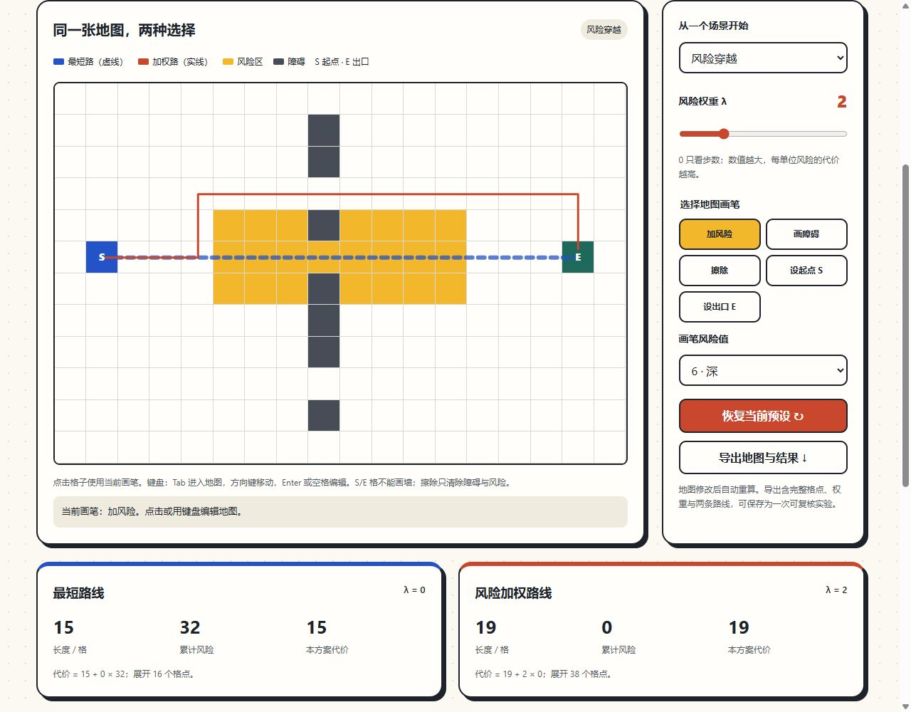

# 寻路与风险实验室 · Evacuation Pathfinding Lab

**最短的路线，什么时候值得绕一绕？** 在同一张合成网格上比较最短路径和风险加权路径，改动地图与权重，观察取舍。

[在线体验](https://hea1.org/evacuation-pathfinding-lab/) · [设计笔记](https://hea1.org/notes/shortest-and-risk/) · [算法与验证](docs/model.md) · [hea1 的小站](https://hea1.org/)



## 可以动手做什么

- 在三张预设地图上比较两条路线，调整风险权重 λ（0—8）。
- 添加风险、切换障碍、擦除格子、移动起点与出口；每次改动自动重算。
- 分别查看长度、累计风险、目标代价与展开格点数；不可达时明确反馈。
- 用方向键与 Enter 编辑地图；窄屏可放大地图并横向滚动。
- 导出完整地图、权重和两条路线为 JSON，使用纯算法模块复现结果。

纯 HTML / CSS / JavaScript，无框架、依赖安装、账户、付费 API 或远程模型。数据留在当前页面，刷新恢复预设；应用不写存储或分析埋点，托管方仍可能保留普通访问日志。

## 五分钟开始

打开在线演示，把 λ 调到 0，再调到 2。在“风险穿越”预设中：

| 方案 | 长度 / 格 | 累计风险 | 按 λ=2 重评的代价 |
| --- | ---: | ---: | ---: |
| 最短路 | 15 | 32 | 79 |
| 加权路 | 19 | 0 | 19 |

随后画一堵墙，或改变起点，再观察结果。该表来自本仓库固定合成场景，不是现实疏散实验。

## 本地运行与复现

安装 Node.js 22+，在仓库根目录执行，无须 `npm install`：

```sh
node scripts/serve.mjs
# 浏览器打开 http://127.0.0.1:8783/
node --test
node scripts/build.mjs
```

服务只监听本机；Ctrl+C 停止，端口可通过 `PORT` 环境变量修改。构建将明确公开清单复制到 `dist/`，不含测试或 Git 文件。也可运行 `npm start`、`npm test`、`npm run build`。

用导出的 JSON 复核：

```js
import { readFile } from 'node:fs/promises';
import { comparePaths } from './pathfinding.mjs';
const saved = JSON.parse(await readFile('pathfinding-experiment.json', 'utf8'));
console.log(comparePaths(saved.grid, saved.weight));
```

## 模型与验证

两方案都用 A*，四邻接，每步代价 `1 + λ × risk[进入的格子]`。曼哈顿启发函数不高估剩余代价，风险非负；起点风险不计。风险是无量纲合成惩罚，λ 表达实验设定，不是校准后的现实风险参数。

8组自动测试包含固定场景、不可达、同起终点、非法输入、非变异和导出复现；100张固定种子随机网格 × 4种权重，与独立 Bellman–Ford 最优代价对比。桌面、390px/320px视口、键盘与主要交互已由AI工具实测。更多细节见[验证文档](docs/model.md)。

## 来源与范围

这是2026年11月为 hea1.org **新实现的静态教学示例**，开发、文档与验证使用 Codex 辅助；延续小站的 C 版视觉。不是旧论文代码恢复，不继承历史改进百分比，不声称维护者独立完成全部开发或已开展真人研究。

没有烟气、火势传播、动态重规划、多楼层、人群、拥堵或出口容量。模型结果不能指导真实火灾或人员疏散，也不构成安全认证。最小化加权代价不保证避开所有风险格点。

代码与文档采用 [MIT](LICENSE)；无第三方运行库。

## English

A browser experiment comparing shortest and risk-weighted A* paths on synthetic static grids. Edit obstacles, risk, endpoints and weight; inspect route metrics and export reproducible JSON. No installation or account is needed for the hosted demo. Run with Node.js 22+ locally. AI-assisted educational implementation; no claim of reproducing thesis results or modelling real evacuation safety.
